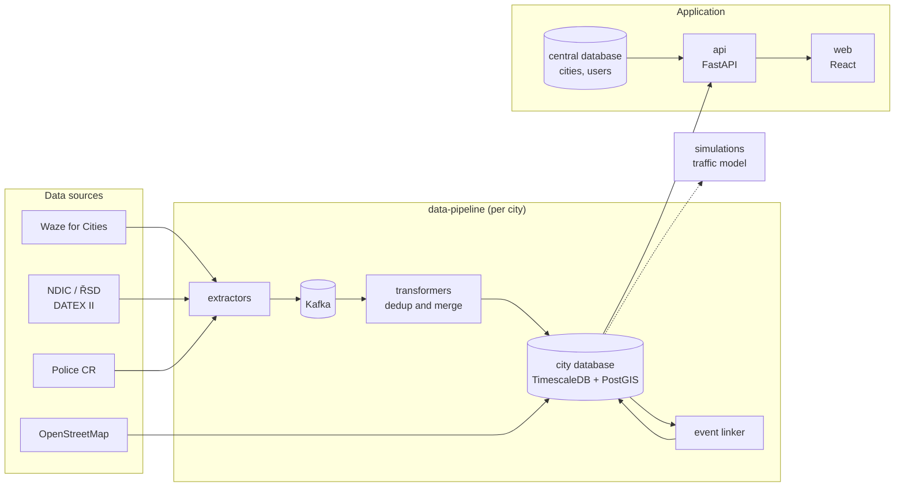

# Analyticity

**Analyticity** is a traffic analytics application for cities. It brings together Waze jams and driver reports, Czech Police accident records and NDIC road closures, places them on the OpenStreetMap road network and links related events (an accident and the jam it caused). Cities see the result on a map, in dashboards and in case studies of specific events.

It is developed at the Faculty of Information Technology, Brno University of Technology, as a research platform for traffic data integration and as an application used with real data.

**Live:** [Brno](https://dexter.fit.vutbr.cz/analyticity/brno/) · e.g. the case study [Pisárky without its tunnels](https://dexter.fit.vutbr.cz/analyticity/brno/case-studies/pisarky)

---

## What it does

- **Map:** jams coloured per road segment, driver reports aggregated in hexagons, police accidents, closures; typical traffic and an accident heatmap.
- **Dashboards:** accidents, jams, hazards and how they relate, compared with the previous period or year.
- **Case studies:** what happened around one event, e.g. how jams moved when two tunnels in Brno closed, checked against a traffic model.
- **Risky road sections:** clusters of accidents with a danger prediction.
- **Administration:** cities, users, colours and personal API keys.
- **One event, several sources:** the same accident reported by Waze and recorded by the police is one record; links between events are scored, not assumed.

---

## Architecture

| Source | What it gives | How often |
|---|---|---|
| Waze for Cities | jams (lines with speed and delay), driver reports | every minute |
| NDIC (ŘSD, DATEX II) | road closures and works; also queues, accidents and weather in the feed | pushed on change |
| Police of the Czech Republic | accidents with cause and consequences, since 2016 | daily, published monthly |
| OpenStreetMap | road network the events are matched to | on import |

Each city has its own database; the services, the API and the web app serve every city. Waze data is shown publicly only in aggregated form, as its terms require.

---

## Repositories

| Repository | What it is | Public |
|---|---|---|
| [`analyticity`](https://github.com/analyticity/analyticity) | **Start here.** Puts the application together (submodules), runs it locally (`./analyticity.sh local:up`) and deploys it | yes |
| [`simulations`](https://github.com/analyticity/simulations) | Macroscopic traffic model of a city (AequilibraE), calibrated on traffic counts | yes |
| `api` | Backend: map, dashboards, case studies, risky sections, raw tables, administration | no |
| `web` | Frontend (React, TypeScript, Leaflet), Czech, Slovak and English | no |
| `data-pipeline` | Extractors, transformers, event linker and database migrations (Java, Quarkus) | no |
| `central_analyticity_db` | Central database: cities, users, settings, API keys | no |
| `docs` | Internal documentation for the team and students: data, data model, guides | no |

Every repository has `main` (development) and `deploy` (what runs on the server). Work goes through a branch and a pull request into `main`.

Older and archived repositories are kept in [analyticity-old-repositories](https://github.com/analyticity-old-repositories).

---

## Research Context

This project is developed as part of a **PhD research** focused on:
- integration of heterogeneous traffic data sources  
- spatial-temporal data matching  
- urban traffic modeling and simulation  

The platform serves as both:
- an experimental environment  
- and a validation tool for proposed methods  

---

## Licensing

All software published by this organization is licensed under the **[GNU Affero General Public License v3.0 or later](https://www.gnu.org/licenses/agpl-3.0.html)**.

You are free to use, study, modify and redistribute it, including for academic research and teaching. One condition matters in particular: if you modify this software and make it available to others over a network — for example by running your own instance of the application or API — you must offer those users the complete corresponding source code of your modified version, under the same license.

Each repository carries its own `LICENSE` file, which is the authoritative text. If you need different licensing terms, please get in touch.

> **Note:** `routing-server` (archived in analyticity-old-repositories) originates from a Bachelor's thesis by Bc. Matyáš Strelec and remains under its original MIT license.

---

## Citation

This project has resulted in (and continues to support) scientific publications in the area of traffic data analysis and integration.

- Ondrušková, M., Hynek, J., & Burget, R. (2025).  **[Towards Street-Level Traffic Analysis Using Waze Crowdsourced Data.](https://ieeexplore.ieee.org/abstract/document/11037686/)** *2025 Smart City Symposium Prague (SCSP)*. IEEE. 

--- 

## Contact

Magdaléna Ondrušková  
Brno University of Technology, Faculty of Information Technology  
Email: iondruskova@fit.vutbr.cz  

---
## Contributing

This project is developed with the support of students contributing as part of their **Bachelor's and Master's theses**.

Current theses (2026/27, alphabetically):
- Márton Bugár – Detection of recurring patterns and anomalies in traffic data (Bachelor's thesis)
- Adam Ďurica – Analysis and visualisation of the impact of weather on traffic (Bachelor's thesis)
- Bc. Adrián Horváth – Time-resolved traffic simulation and modelling the impact of extraordinary events (Master's thesis)
- Bc. Andrea Michlíková – Automatic generation of traffic zones for a macroscopic traffic model (Master's thesis)
- Bc. Filip Polomski – Analysis and visualisation of the impact of car traffic on public transport in Brno (Master's thesis)
- Erik Svitaň – Propagation of traffic events in the road network (Bachelor's thesis)
- David Tomaško – Automatic categorisation of city events and analysis of their impact on traffic (Bachelor's thesis)

Finished theses (by year, alphabetically):
- 2026, Bc. Štěpán Bakaj
- 2026, Maksim Dubrovin
- 2026, Bc. Patrik Haas
- 2026, Bc. Adam Kaňkovský
- 2026, Anna Shevchenko
- 2025, Bc. Matyáš Strelec – Routing Algorithm for Traffic Planning in Brno [thesis](https://www.vut.cz/studenti/zav-prace/detail/164964)
- 2025, Bc. Veronika Šimková – Analysis and Visualization of Traffic Accident Data [thesis](https://www.vut.cz/studenti/zav-prace/detail/164963)

---
## Acknowledgements

This work was carried out under the supervision of:

- Ing. Jiří Hynek, Ph.D.  
- doc. Radek Burget, Ph.D.  

I would like to sincerely thank them for their guidance, patience, and continuous support throughout my PhD studies. Their insights, feedback, and willingness to discuss ideas have been invaluable not only for this project, but for my research as a whole.

---

## Note

This project is under active development as part of ongoing research.
